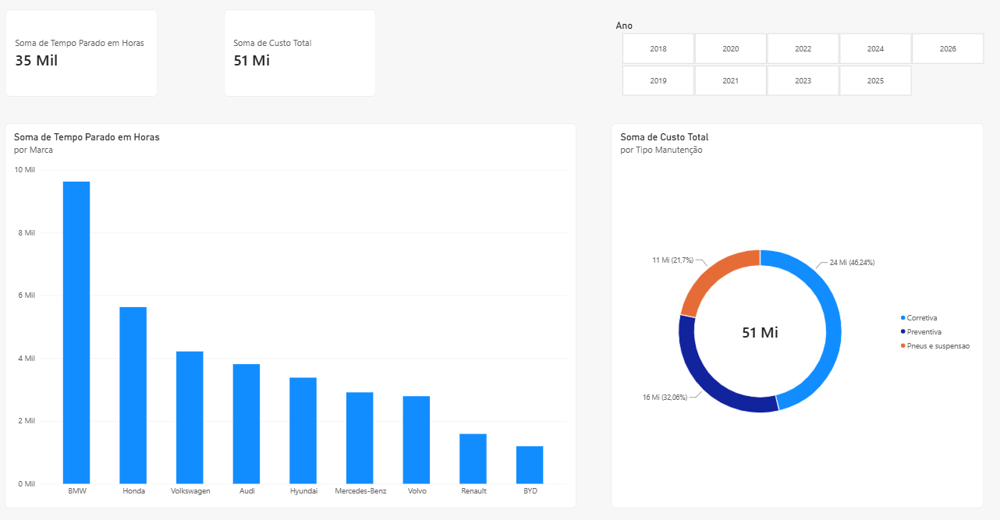

# 📊 Análise de Custos e Tempo Parado em Manutenção de Frota

Projeto completo de análise de dados desenvolvido com **Python**, **SQL** e **Power BI** para monitoramento de indicadores-chave (KPIs) de manutenção veicular, permitindo identificar gargalos operacionais, marcas com maior tempo de inatividade e distribuição de gastos por tipo de serviço entre **2018 e 2026**.



---

## 🎯 Objetivo do Projeto

Consolidar os registros históricos de manutenção (`manutencoes`) e cadastro de veículos (`veiculos`) em uma visão executiva única para apoiar a tomada de decisão na gestão de frotas, respondendo a três perguntas principais:
1. Qual é o volume financeiro total e o tempo acumulado de inatividade da frota?
2. Quais tipos de manutenção concentram a maior fatia do orçamento?
3. Quais fabricantes apresentam maior impacto em horas paradas?

---

## 📈 Principais Indicadores e Insights

* **Custo Total de Manutenção:** **R$ 51 Mi** acumulados no período analisado.
* **Tempo Parado Total:** **35 Mil horas** de indisponibilidade operacional da frota.
* **Distribuição por Tipo de Manutenção:**
  * **Corretiva:** ~R$ 24 Mi (**46,24%**) — principal ofensor financeiro, indicando oportunidade para reforçar planos preventivos.
  * **Preventiva:** ~R$ 16 Mi (**32,06%**).
  * **Pneus e Suspensão:** ~R$ 11 Mi (**21,70%**).
* **Impacto por Marca:** A fabricante **BMW** lidera o ranking de horas paradas, seguida por Honda e Volkswagen, exigindo acompanhamento específico de disponibilidade e peças.

---

## 🛠️ Ferramentas e Técnicas Utilizadas

* **Python (`gerar_base.py` e `analise_frota.py`):** Geração, tratamento e análise exploratória das bases de dados.
* **SQL (`queries_frota.sql`):** Estruturação das tabelas relacionais (`veiculos` e `manutencoes`) e consultas analíticas.
* **Power BI Desktop (`power bi project.pbix`):** Modelagem relacional, criação de indicadores e dashboard interativo com filtros dinâmicos por ano (`2018–2026`).

---

## 📂 Estrutura do Repositório

```text
├── assets/
│   └── dashboard_frota.png    # Captura de tela do painel finalizado
├── dados/
│   ├── manutencoes.csv        # Base histórica de manutenções
│   └── veiculos.csv           # Base cadastral da frota
├── Python/
│   ├── analise_frota.py       # Script de análise exploratória
│   └── gerar_base.py          # Script de geração dos dados
├── sql/
│   └── queries_frota.sql      # DDL e consultas SQL do projeto
├── power bi project.pbix      # Arquivo editável do Power BI Desktop
└── README.md                  # Documentação do projeto e insights
